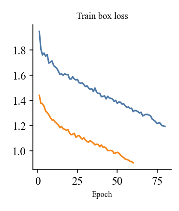
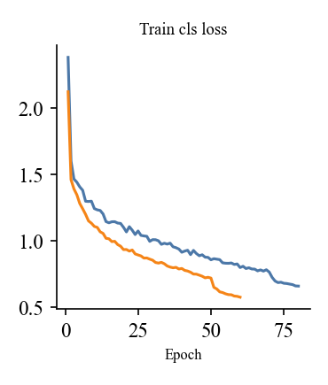
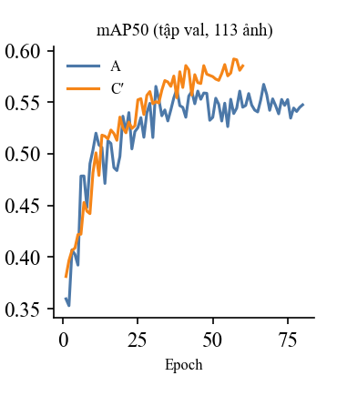
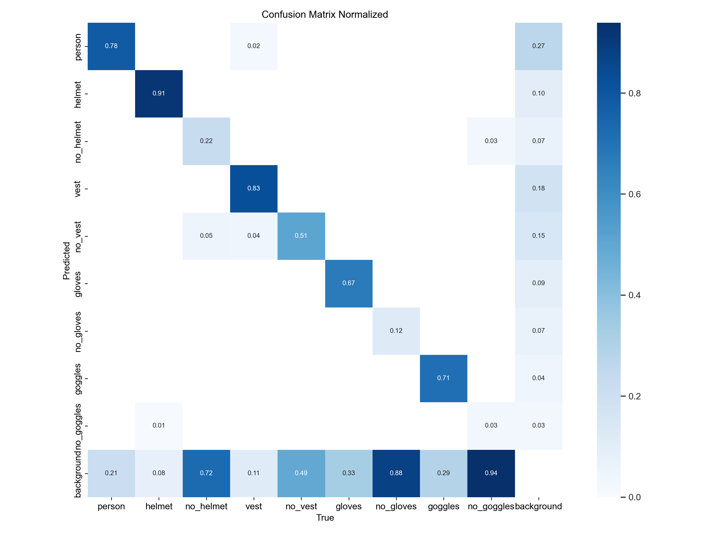
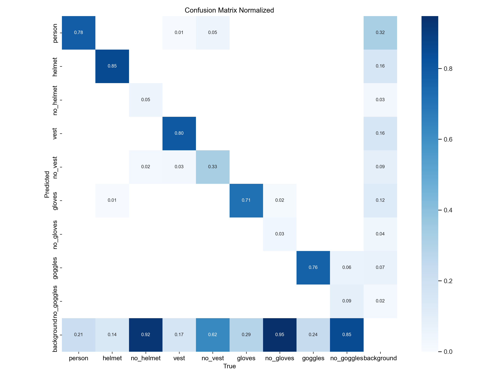
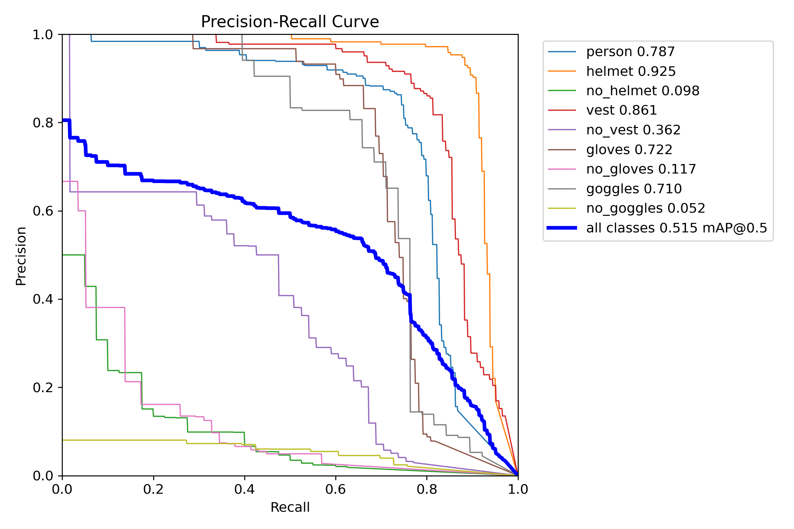
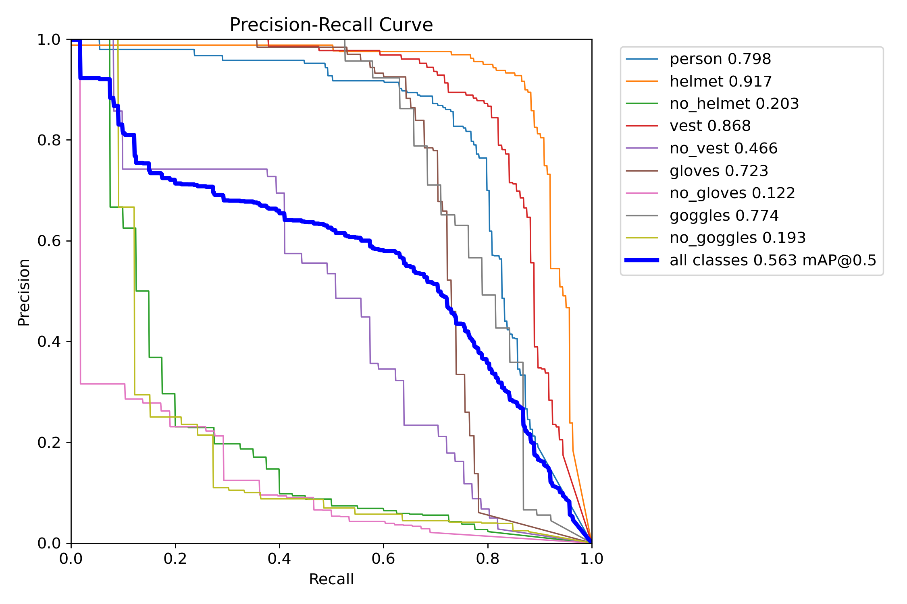
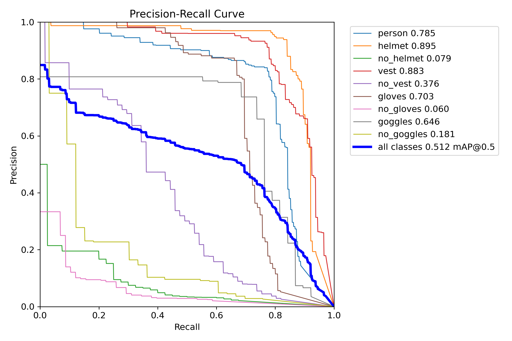

# Đọc các hình kết quả của A, C′, C″ — khác nhau gì, cho biết gì

Hình nằm trong `docs/img_giai_thich/` (đường dẫn tương đối, xem file này trong VS Code/Typora thì thấy ảnh). Ảnh gốc của ba cấu hình ở `Bang_Chung_Chay/<A|C_prime|C_second>/val_test_640/`. Mọi số đo trên **111 ảnh test**, ảnh 640, đánh giá lại ngày 31/10/2026.

## 1. A, C′, C″ khác nhau ở đâu

Cả ba là **cùng một model** (YOLOv8n, 3,14 triệu tham số) và **cùng cách huấn luyện** (fine-tune từ `yolov8n.pt`, batch 16, ảnh 640). Chỉ khác **dữ liệu train**:

| | A | C′ (được chọn) | C″ |
|---|---|---|---|
| Dữ liệu train | Construction-PPE | A + 2.500 ảnh PPEv5 | C′ + 2.538 ảnh SH17 |
| Số ảnh train | 1.132 | 3.632 | 6.170 |
| Epoch | 80 | 60 | 60 |
| Nơi chạy | Máy cá nhân | Máy cá nhân | Google Colab T4 |
| Có đường cong huấn luyện | Có | Có | **Không** (log mất khi runtime Colab hết hạn) |
| mAP50 (test) | 0,515 | **0,563** | 0,512 |

Vì chỉ khác dữ liệu, so A với C′ cho biết **thêm PPEv5 có ích không**, so C′ với C″ cho biết **thêm SH17 có ích không**. Mỗi cấu hình chỉ train một lần và test chỉ 111 ảnh, nên chênh khoảng 0,02 là nhiễu.

## 2. Đường cong huấn luyện (có cho A và C′)

Mỗi điểm là một epoch (một lượt model xem hết ảnh train). Xanh = A (80 epoch), cam = C′ (60 epoch).

### 2.1 Train box loss — sai số vị trí hộp

- **Ý nghĩa:** hộp model vẽ lệch bao nhiêu so với hộp nhãn trên ảnh train. Càng thấp càng khớp.
- **Nhìn thấy:** cả hai giảm đều, không bị vọt lên: huấn luyện ổn định, không hỏng. A giảm từ khoảng 1,95 xuống 1,2; C′ từ khoảng 1,45 xuống 0,9.
- **Đừng hiểu sai:** C′ thấp hơn A **không** có nghĩa C′ tốt hơn. Hai cấu hình học trên dữ liệu khác nhau (C′ có nhiều ảnh PPEv5 cận cảnh, dễ hơn), nên loss không so thẳng với nhau được.

### 2.2 Train cls loss — sai số phân loại

- **Ý nghĩa:** model đoán sai tên lớp (helmet, vest, ...) bao nhiêu trên ảnh train.
- **Nhìn thấy:** giảm nhanh ở vài epoch đầu (model học các lớp dễ), sau đó giảm chậm. Cùng kiểu với box loss; cùng cảnh báo là không so A với C′ bằng đường này.

### 2.3 mAP50 trên tập val — hình quan trọng nhất của nhóm này

- **Ý nghĩa:** điểm chính xác trên **113 ảnh val** (ảnh model không học), đo sau mỗi epoch. Đây mới là thước đo "model có tiến bộ thật không".
- **Nhìn thấy:**
  - Cả hai tăng nhanh đến khoảng epoch 15–25, sau đó **đi ngang và dao động** (A trong khoảng 0,53–0,57, C′ trong khoảng 0,55–0,59). Dấu hiệu model đã học gần hết những gì dữ liệu cho được.
  - C′ nhỉnh hơn A khoảng 0,03 ở cuối (C′ khoảng 0,585 ở epoch 60), nhưng đường dao động nên chênh này không chắc chắn.
- **Dùng để làm gì:** chọn `best.pt` (epoch có val mAP cao nhất), và biết có cần train thêm không. Ở đây train thêm cũng không giúp nhiều.
- **Lưu ý:** mAP50 ở hình này đo trên tập **val** (113 ảnh), khác con số 0,563 ở bảng, đo trên tập **test** (111 ảnh).

## 3. Ma trận nhầm lẫn (confusion matrix)

### Cách đọc

- **Cột (True, trục ngang):** loại thật của vật trong ảnh.
- **Hàng (Predicted, trục dọc):** loại model đoán.
- **Ô chéo** (từ trên trái xuống dưới phải): đoán đúng. Số trong ô là **tỉ lệ vật thật loại đó mà model tìm đúng** (chuẩn hóa theo cột), tức là **recall** của lớp.
- **Hàng dưới cùng "background":** vật thật có mặt nhưng model **không thấy** (bỏ sót). Ô đậm ở đây là điểm yếu.
- **Cột cuối "background":** model báo có vật nhưng thực tế **không có** (báo nhầm).
- Ô lệch khỏi đường chéo ở giữa: model **nhầm loại** này sang loại kia.

### Ba cấu hình, theo thứ tự A, C′, C″

**A**

**C′ (được chọn)**

**C″**

### Số đọc từ ba ma trận (chéo = tìm đúng; "bỏ sót" = hàng background)

| Lớp | A tìm đúng | C′ tìm đúng | C″ tìm đúng | Bỏ sót A / C′ / C″ |
|---|---|---|---|---|
| person | 0,78 | 0,77 | 0,78 | 0,21 / 0,23 / 0,21 |
| helmet | 0,91 | 0,88 | 0,85 | 0,08 / 0,11 / 0,14 |
| vest | 0,83 | 0,80 | 0,80 | 0,11 / 0,15 / 0,17 |
| gloves | 0,67 | 0,71 | 0,71 | 0,33 / 0,28 / 0,29 |
| goggles | 0,71 | 0,71 | 0,76 | 0,29 / 0,29 / 0,24 |
| no_helmet | 0,22 | 0,15 | 0,05 | 0,72 / 0,82 / 0,92 |
| no_vest | 0,51 | 0,54 | 0,33 | 0,49 / 0,43 / 0,62 |
| no_gloves | 0,12 | 0,07 | 0,03 | 0,88 / 0,93 / 0,95 |
| no_goggles | 0,03 | 0,09 | 0,09 | 0,94 / 0,88 / 0,85 |

(Đọc bằng mắt từ ảnh, làm tròn hai chữ số; ma trận tính ở ngưỡng tin cậy mặc định của Ultralytics, mình chưa kiểm giá trị chính xác của ngưỡng đó.)

### Ta biết được gì từ đây

1. **Các món "có mặt" (helmet, vest, gloves, goggles) được tìm đúng khoảng 0,7–0,9.** Mũ tốt nhất (0,85–0,91), găng và kính ở khoảng 0,67–0,76.
2. **Các lớp "không mang" (`no_*`) gần như không bao giờ được nhận ra** (0,03–0,22 ở mọi cấu hình, `no_gloves` chỉ 0,03–0,12), và hầu hết bị bỏ sót vào "background". Đây là lý do hệ thống **không dựa vào `no_*`** mà dùng quy tắc "không thấy món thì coi là thiếu" ở demo.
3. **Thêm dữ liệu không cải thiện đều:** từ A sang C′ sang C″, helmet và `no_helmet` giảm, `no_vest` giảm mạnh ở C″ (0,54 → 0,33), còn gloves và goggles tăng chút ít. C″ tìm được nhiều kính hơn (0,76) nhưng mAP kính lại thấp nhất (0,646): nghĩa là nó **báo nhầm nhiều hơn** (cột background của kính tăng), nên precision giảm.
4. **Khoảng 21–23% người thật bị bỏ sót** (hàng background của person). Cột cuối cho biết trong các lần báo nhầm (báo có vật mà thực tế không có), khoảng 27–32% là báo nhầm thành "người": phần nào do ảnh test có người bị che hoặc chỉ lộ một phần.

## 4. Đường cong Precision–Recall (PR)

### Cách đọc

- **Trục ngang Recall:** tìm được bao nhiêu phần vật thật. **Trục dọc Precision:** trong những cái model báo, bao nhiêu phần đúng.
- Mỗi đường là một lớp. Model đổi ngưỡng tin cậy từ cao xuống thấp: ngưỡng cao thì báo ít nhưng đúng (góc trên trái), ngưỡng thấp thì tìm được nhiều nhưng báo nhầm nhiều (xuống dưới phải).
- **Diện tích dưới đường = AP50 của lớp** (số trong chú giải). Đường **cao và đi xa sang phải** là tốt. Đường thấp, co về góc trái dưới là lớp model làm kém.
- Đường **xanh dương đậm "all classes"** là trung bình các lớp, chính là **mAP50**.

### Ba cấu hình

**A**

**C′ (được chọn): mAP50 0,563**

**C″**

### AP50 từng lớp (mAP50 = trung bình)

| Lớp | A | C′ | C″ |
|---|---|---|---|
| helmet | 0,925 | 0,917 | 0,895 |
| vest | 0,861 | 0,868 | 0,883 |
| gloves | 0,722 | 0,723 | 0,703 |
| goggles | 0,710 | 0,774 | 0,646 |
| person | — | 0,798 | 0,785 |
| no_helmet | — | 0,203 | 0,079 |
| no_vest | — | 0,466 | 0,376 |
| no_gloves | — | 0,122 | 0,060 |
| no_goggles | — | 0,193 | 0,181 |
| **mAP50** | 0,515 | **0,563** | 0,512 |

(Dấu "—": mình chưa đọc số này của A; xem chú giải trong `A_PR_curve.png`.)

### Ta biết được gì từ đây

1. **Lớp tốt và lớp kém tách rõ:** mũ, áo, người, kính, găng đường cao (AP 0,72–0,92); các lớp `no_*` đường thấp (AP 0,06–0,47). Cùng kết luận với ma trận nhầm lẫn.
2. **mAP50 chung 0,563 bị kéo xuống bởi bốn lớp `no_*`** — không có nghĩa model nhận món kém. Vì vậy nhóm báo AP50 **từng món** chứ không chỉ mAP chung.
3. **Chọn C′ vì tổng thể cao nhất**, đặc biệt kính (0,774 so 0,710 ở A và 0,646 ở C″). Mũ và áo thì ba cấu hình gần như bằng nhau.
4. **Ngưỡng làm việc:** đường PR cho biết nếu muốn precision 0,8 thì recall của găng chỉ còn khoảng bao nhiêu; hệ thống chọn ngưỡng ưu tiên recall cao (thà báo nhầm hơn bỏ sót), nên chấp nhận precision thấp hơn.

## 5. Tóm tắt: ba nhóm hình, mỗi hình trả lời câu hỏi gì

| Hình | Câu hỏi trả lời | Dùng để |
|---|---|---|
| Đường cong loss (box, cls) | Huấn luyện có ổn định, có hội tụ không | Kiểm tra quá trình học; không so A với C′ |
| Đường cong mAP50 trên val | Model có tiến bộ thật theo epoch không, dừng khi nào | Chọn `best.pt`, quyết định có train thêm không |
| Ma trận nhầm lẫn | Món nào tìm thấy, món nào bị bỏ sót, món nào bị nhầm loại hay báo nhầm | Hiểu **kiểu lỗi** của model |
| Đường cong PR | Đổi ngưỡng tin cậy thì precision và recall đánh đổi ra sao, AP từng lớp | So các cấu hình, chọn ngưỡng |

## 6. Câu thầy có thể hỏi

- **Vì sao loss của C′ thấp hơn A mà không nói C′ tốt hơn?** Vì dữ liệu train khác nhau nên loss không cùng thước; thước công bằng là mAP/AP trên cùng tập val hoặc test.
- **Vì sao mAP50 chỉ 0,56?** Là trung bình 9 lớp, trong đó bốn lớp `no_*` rất thấp (0,06–0,47). Mũ 0,92, áo 0,87.
- **Model có overfitting không?** Đường val mAP đi ngang và dao động, không sụt hẳn, nên chưa thấy dấu hiệu overfit rõ; nhưng val chỉ 113 ảnh nên không khẳng định mạnh.
- **Vì sao không có đường cong của C″?** Runtime Colab hết hạn trước khi lưu `results.csv`; còn `best.pt` và kết quả đánh giá (cả trên Colab lẫn máy cá nhân khớp nhau).
- **Vì sao hệ thống không dùng `no_helmet`, `no_gloves`?** Ma trận cho thấy các lớp này gần như không được nhận ra (chỉ 0,03–0,22), nên demo dùng quy tắc "không thấy món thì coi là thiếu".
